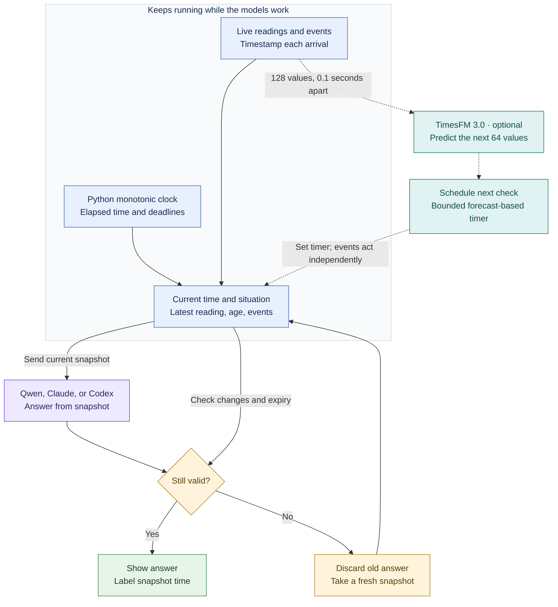

# TickLM

**A live sense of time for language models.**

The idea is simple: an assistant should notice that a deadline has passed, that its information is getting old, or that something changed while it was writing an answer. It should be able to do this without waiting for someone to send another message.

TickLM adds a small program around a language model. That program watches the clock and incoming information, tells the model when it needs to respond, and checks whether its answer is still usable before showing it.

The controller and TimesFM run locally. Language responses can come from local Qwen, Claude Code, or Codex. The live experiments described below used frozen models.

**New experiment, 3 November 2026: TickLM TimePatch.** A small trained adapter for **Qwen3-0.6B** answered all 256 held-out questions and all 128 counterfactual pairs correctly within four trained policies, using durations calculated by an external program. It also made five correct decisions in a short real-clock replay. It failed a reversed-rule test and damaged ordinary arithmetic when active, so the prototype explicitly disables the adapter for ordinary language requests. Read the [results and limitations](docs/weight-surgery-results.md), [research journey](docs/weight-surgery-journey.md), [experiment plan](docs/weight-surgery-plan.md), and [evidence index](evidence/weight-surgery-20261103/journey-index.json). This is a temporal-policy specialist with an external clock; TimesFM and the 17M decision model were not fused in this intervention.

## What this looks like

Imagine an assistant monitoring a door. It starts writing “the door is closed.” Before it finishes, the door opens.

The program records the change while the assistant is still writing. It catches the outdated answer, keeps it out of the user-facing output, and asks the assistant to respond using the new information. Any timers keep running throughout.

That is the kind of behavior this project is trying to make work.

## Which models did we use?

The original experiment ran Qwen and TimesFM locally on an **Apple M4 Max**, using MLX, Apple's software for running models on Apple Silicon. We subsequently ran the same live test protocol through Claude Code and Codex, whose language models respond through their cloud services.

| Part | Exact implementation | Its job |
|---|---|---|
| Clock and event watcher | Python's `time.monotonic()` and our `TemporalState` program | Calculate elapsed time, track deadlines and incoming changes, and check whether an answer is still usable. |
| Language model | **Qwen3-4B abliterated**, stored in a compressed 4-bit format | Read a supplied account of the current time and situation, then answer questions about it. |
| Frontier alternatives | **`claude-opus-5-5`** through `cca startup`, or **`gpt-6-astra`** through Codex | Answer the same scripted questions from supplied snapshots while the local clock keeps running. |
| Optional forecasting model | **Google TimesFM 3.0**, checkpoint `google/timesfm-3.0-pytorch`, run through [Rachitt's MLX implementation](https://github.com/rachittshah/mlx-tsfm) | Predict future numerical measurements so the program can choose when to ask Qwen to check again. |

**The clock tells us how much time has passed. TimesFM predicts what might happen next.** The forecasting model is not needed to count seconds or enforce a deadline.



The dashed path is the optional forecast-based timer. TimesFM does not calculate elapsed time, and its forecast is not fed into the language model as a learned representation. In this prototype, it changes **when the language model is called**. The clock and event watcher supply **what that model knows about time**.

## What happened with Claude Code and Codex?

Both clients completed a clock-only trial and a TimesFM-assisted trial. All four graded answers were correct in every trial, but some arrived too late to publish under the existing timing rules.

| Client | Observed model | Clock-only trial | With TimesFM | Publishable graded answers |
|---|---|---|---|---|
| Claude Code through `cca startup` | `claude-opus-5-5` | 46.54 seconds, 409 readings | 58.17 seconds, 515 readings | 3 of 4 in each run |
| Codex | `gpt-6-astra` | 71.66 seconds, 650 readings | 143.03 seconds, 1,328 readings | 2 of 4 in each run |

In all four runs, an alarm and a deadline were handled while answer text was streaming; the old answer was rejected, and a refreshed `ALARM; EXPIRED` answer was published. Both TimesFM timers also fired and started another call. **None of the frontier runs passed the complete freshness test.** In particular, both models correctly answered `STALE` about a snapshot after new measurements had already arrived. Both forecast-triggered status reports also expired before publication; they are outside the four graded answers in the table.

These are single scripted trials with `xhigh` effort requested, different client overhead and different live input sequences. The durations are not a general model ranking or evidence of a TimesFM speedup. Read the [frontier results and raw evidence](docs/frontier-results.md) for timings, failures, token accounting and reproduction commands.

## What exactly did we measure?

The **original local Qwen-and-TimesFM test** ran for **24.69 seconds after model warmup**, received **201 simulated numerical readings**, made **7 calls to Qwen**, and made **1 TimesFM forecast**. These counts describe one scripted run, not 201 independent tests.

### 1. Time between point A and point B

Point A was the start of the live run. Point B was the moment the program prepared a snapshot for Qwen. Python's monotonic clock measured both points; the program subtracted A from B:

```text
A: run starts             49066.418777208 seconds on the monotonic clock
B: snapshot is prepared   49070.946509750 seconds on the same clock
B minus A                     4.527732542 seconds elapsed

Text supplied to Qwen: "Run elapsed time: 4.528 seconds since run start,
                       measured with a monotonic clock."
Qwen's answer:         "4.528"
```

These are elapsed-clock readings, not times of day. **The program calculated the interval; Qwen reported the value it was given.** This checks whether Qwen uses current clock information. It does not show Qwen independently measuring time, doing the subtraction, or learning an internal clock. The answer describes point B; additional time passed while Qwen generated it.

### 2. Changes arriving while Qwen was answering

An alarm arrived after Qwen had generated its first token. A deadline set for **250 milliseconds later** fired while Qwen was still writing. The program rejected that outdated answer and asked again; Qwen then answered **`ALARM; EXPIRED`**. After the measurement source was paused, Qwen also reported **`STALE`** using the supplied one-second freshness rule.

### 3. What TimesFM actually did

The 201 readings were numbers from a simulated sensor, generated about once every **0.1 seconds** as real time passed, with an intentional **three-second pause**. They were not physical sensor measurements or language-model outputs.

By the time TimesFM was called, **185 readings** had arrived. The program used recent readings to construct **128 evenly spaced input values**, covering **12.7 seconds**, and asked TimesFM to predict **64 future values**, covering **6.4 seconds**. A simple rule looked for the first predicted change of at least one unit. TimesFM's forecast put that change **1.1 seconds** after the last input reading, so the program scheduled a check for that time. The timer fired and Qwen was called with an updated snapshot.

TimesFM took **67.39 milliseconds** for that forecast. A cheap predictor fitted to the recent numerical history took **3.71 milliseconds** and suggested **1.3 seconds**. We executed the TimesFM timer; we did not establish that its suggestion was more accurate or saved computation.

The final local Qwen trial without TimesFM passed **10 of 10 scripted checks**; its version with TimesFM passed **12 of 12**. A separate test also passed with events written to a real file during generation. The [local results report](docs/live-results.md) explains each measurement, the actual timeout limits, model identities, and links to the recorded prompts and answers.

**Timing clarification:** the retained run lasted 24.69 seconds. Its safety limits were 90 seconds for model warmup after worker launch and 70 seconds for the live test; neither limit was reached. We have no retained evidence of a 21-minute timeout or a 21-minute live test.

## What we have not proved

We have built a working way to give the **combined system** current information about time. We have not taught the language model to keep its own internal clock.

We have also not shown that TimesFM chooses better times to check than a simple rule or cheap predictor. The clock-only version already handles passing time, deadlines, and incoming changes. TimesFM's added value remains a research question.

These were short, scripted tests. They do not establish reliability across arbitrary conversations, long-running use, or production failures. Earlier attempts gave wrong answers; those failures are retained in the repository.

## Try it

TickLM can use **Claude Code through `cca startup`** or **Codex**, using their existing local sign-ins. Start with the clock and event tests:

```bash
.venv/bin/python realtime.py self-test --provider claude \
  --model claude-opus-5-5 --claude-profile startup --effort xhigh \
  --clock-only --trial-timeout-s 240 --run-dir artifacts/my-claude-trial

.venv/bin/python realtime.py self-test --provider codex \
  --model gpt-6-astra --effort xhigh \
  --clock-only --trial-timeout-s 240 --run-dir artifacts/my-codex-trial
```

Use a new output directory for every run. Omit `--clock-only` to include the local TimesFM model. The same `--provider` options also work with the `watch` command below.

These runs use fresh conversations and record the model identity reported by the client. Claude launches through the `startup` account with `--safe` and `--safe-mode`; Codex uses its streaming app server. Timings include client startup, network delays and model response time. The clients do not enforce this experiment's requested output-token caps.

The 240-second limit allows a longer test after warmup. It **does not extend** the normal six-second answer validity window, the one-second measurement freshness rule, or either deadline. A correct but outdated answer is retained in the diagnostic record and rejected from publication. Inspect `answer_correctness`, `publication_checks` and `response_measurements` separately in the saved summary.

To run the original local Qwen model on the existing setup:

```bash
cd /Users/rachitt/labs/temporal-bridge
.venv/bin/python realtime.py self-test --run-dir artifacts/my-live-demo
```

This runs the demonstration with TimesFM. Add `--clock-only` to test the simpler version. Use a new output directory for each run.

<details>
<summary>Installation and model details</summary>

The tested setup uses Python 3.12 on an Apple Silicon Mac, a local language model, and [Rachitt's TimesFM implementation for MLX](https://github.com/rachittshah/mlx-tsfm). MLX is the software used here to run the models on the Mac.

```bash
cd /Users/rachitt/labs/temporal-bridge
uv venv --python 3.12 .venv
uv pip install --python .venv/bin/python -e '.[dev]' -e /Users/rachitt/mlx-tsfm
```

The default language model is Qwen3-4B abliterated, stored in a compressed 4-bit format at `/Users/rachitt/labs/qwen3-4b-abliterated-mlx/models/qwen3-4b-abliterated-4bit`. To use another compatible local model, add `--model /path/to/model`.

The TimesFM implementation used during development was commit `c834636e97f98940d95e34601a17de3886bf79d3`. Its model files are pinned to revision `43046b85ec22d584a13f8098c2ed39c889e129c2` of `google/timesfm-3.0-pytorch`. The model's [non-commercial license](https://huggingface.co/google/timesfm-3.0-pytorch) applies. Model files and local caches are not stored in this repository.

</details>

<details>
<summary>Watch your own incoming information</summary>

Create an empty file and start the watcher:

```bash
mkdir -p data
touch data/live-events.jsonl
.venv/bin/python realtime.py watch --clock-only --events data/live-events.jsonl \
  --seconds 120 --run-dir artifacts/my-events
```

From another terminal or a sensor program, append one JSON object per line:

```json
{"type":"sample","value":42.5}
{"type":"event","name":"door","payload":{"open":true}}
{"type":"deadline","id":"follow_up","after_s":10}
```

The watcher ignores anything already in the file when it starts. Omit `--clock-only` to enable forecast-based checks after enough suitably spaced measurements arrive. `--change-threshold` sets how large a numerical change must be to trigger attention; its default is 1.0 in your measurement's units.

To watch the Mac's system load instead, leave out `--events`:

```bash
.venv/bin/python realtime.py watch --clock-only --seconds 60 \
  --deadline-seconds 20 --run-dir artifacts/my-watch
```

The displayed answer is labeled with the time of the information it used. A separate clock shows the time when the answer is presented. Rejected answers stay in the diagnostic log and are not displayed as answers.

There are limits to this file-based input. The program knows when it reads a record, not when someone originally wrote or measured it. A delayed record can therefore have an unknown real-world age. Relative deadlines start when the program reads them. Replacing or shortening the input file can also cause records to be missed. This is a prototype, not a guaranteed delivery system.

</details>

<details>
<summary>Tests, research, and full evidence</summary>

```bash
.venv/bin/python -m pytest -q
.venv/bin/ruff check src tests app.py realtime.py
git diff --check
```

The latest verification is **127 automated tests passed, 1 skipped**. The skipped test is the opt-in local model/file-watcher test, which passed separately during the original local experiment. All four frontier trials were actually executed and their failed freshness checks are retained. Code checks also passed.

- [Results in plain language](docs/live-results.md)
- [Claude Code and Codex results](docs/frontier-results.md)
- [Live-system design](docs/realtime-design.md)
- [Research papers on real-time agents](docs/realtime-research.md)
- [Independent review](docs/realtime-final-review.md)
- [Raw records, including failed attempts](evidence/README.md)

The earlier static forecasting experiment addressed the wrong version of the question. Its [failure analysis](docs/failure-analysis-v1.md) and [recorded results](evidence/static-v1/) are preserved for inspection. They are not evidence of a live sense of time.

</details>
