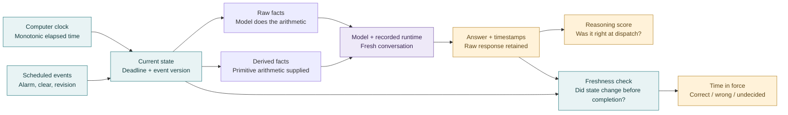

# TickLM-Bench

**Can a language model give the right answer while time passes and the world changes?**

TickLM-Bench tests two different abilities. First, can a model apply a time rule correctly when a relevant fact changes? Second, can a running system produce a useful answer before that answer becomes stale? The computer supplies the clock. The language model interprets the facts and rules. These measurements do not establish an internal clock, subjective time perception, or a new capability in unchanged model weights.

This is an exploratory first release, dated **3 November 2026**. The [measured results](results.md), [research report](report.md), [frozen protocol](preregistration.md), and [prior-art review](../../docs/benchmark-prior-art.md) explain what was run and what the evidence supports. Exo was excluded at the user's request.

Download the [205-file evidence archive](evidence/ticklm-bench-v0.1-evidence.tar.gz) and its [file-by-file checksum manifest](evidence/manifest.json). The [offline parser replay](parser-replay/replay.md) is a separate post-hoc analysis of the original live recordings.



## What the models are asked to do

For example, a task can say: the timer began at 107.25 seconds, it is now 112.75 seconds, and an alert is required after 5.75 seconds. The elapsed time is **112.75 − 107.25 = 5.5 seconds**, so the alert is not due. A paired case changes one relevant fact and requires a different answer. This illustrative calculation matches a development case; it is not a new measurement of how accurately a model's internal clock runs.

There are seven task families: elapsed duration, temporal policies, interval relations, revisions, event-time windows, calendar arithmetic, and chronology. Each paired episode is presented as raw facts and with primitive derived arithmetic. The derived view supplies no correct answer or decision label. Two independent implementations check the generated answer keys.

The frozen screening tier has **112 requests per system**: seven families × four paired episodes × two variants × two views. The full tier has **448 requests**, including the screen, and is reported separately. A later resource-driven **28-request micro tier** contains one exact screen episode per family for expensive client-harness measurements. The full models were selected before test outcomes; the overlapping full tier is not an independent replication of the screen.

The primary parser accepts an entire letter-only answer or the narrow equivalent formats specified in the protocol. Invalid responses count wrong. A separately labeled, post-hoc diagnostic accepts an entire exact option line, such as `D. Include the event`, because the first Qwen run consistently used that format. It does not extract convenient letters from an explanation.

## How the live test works

The live controller records point A with `time.monotonic()`. At point B it computes `B − A`, looks up the events that should already have happened, and sends that snapshot to the model. Each of three prescribed trajectories lasts 30 seconds. Events keep advancing while inference runs. Completion can occur after a deadline, after an event update, or after the trajectory has ended.

We separately measure whether the answer was correct for its input snapshot, correct at completion, and current enough to publish. We also integrate how many seconds a decision remains correct, wrong, or absent. A slow model can answer every input correctly yet spend much of the live trajectory acting on old information.

Three publication policies are compared using the same retained responses: unguarded answers; a practical freshness-only check that expires answers when state changes; and an **oracle-assisted reference** that also knows whether an answer is correct. The oracle-assisted policy is a diagnostic upper reference, not a deployable guard. This controlled simulation does not prove atomic publication or production reliability.

## Reproduce

Use Python 3.12. The captured environment uses NumPy 2.5.4, MLX 0.32.4, and MLX-LM 0.32.2. MLX local inference requires Apple Silicon; HTTP and native-client imports are lazy. Cross-platform execution was not validated by this release.

```sh
uv venv
source .venv/bin/activate
uv pip install -e '.[dev]'
python -m ticklm_bench.runner freeze --output artifacts/my-frozen-data --seed 11032026
python -m ticklm_bench.runner run \
  --dataset artifacts/my-frozen-data/screen.jsonl \
  --config benchmarks/ticklm-v0.1/configs/qwen3-06b-mlx.json \
  --output artifacts/my-qwen-run
python -m ticklm_bench.live \
  --config benchmarks/ticklm-v0.1/configs/qwen3-06b-mlx.json \
  --output artifacts/my-qwen-live --duration 30 --trajectories 3
python -m ticklm_bench.report --runs artifacts/my-runs --output artifacts/my-report
```

Activate the environment first or replace `python` with `.venv/bin/python`. The example model path must refer to the pinned checkpoint. Download public models with `ticklm_bench.catalog` and `ticklm_bench.provision`; the captured catalog, revisions, and file hashes are in the release evidence. Never place credentials in configuration files. Direct paid requests require a verified route, pricing, billable cap, and shared $25 budget ledger; this release used local inference and existing client subscriptions where available.

Run `python -m pytest -q` and `ruff check src/ticklm_bench tests/test_ticklm_*.py` for validation. Native client versions, prompt templates, quantization, reasoning controls and unsupported controls are part of each result. A model listing or download is not a completed benchmark run.

## Limits

The questions are synthetic, in English, and share templates between development and test. Fresh numerical seeds do not establish contamination resistance. Some families have only two plausible actions despite four answer letters. Calendar coverage and chronology relations are narrow. The screen has only four paired episodes per family; its bootstrap intervals can collapse at a score of zero or one and do not resolve close model rankings. Option-order invariance, multilingual transfer, robust forecasting, and official external benchmark scores are not established.

TimesFM and Bekko are relevant to the earlier forecasting/decision experiments, but neither is a language-model competitor in this evaluation. Their presence on disk is not counted as another model run. The earlier TimePatch training and its specialized results are documented in the [weight-surgery report](../../docs/weight-surgery-results.md); those public examples are not the new test set.

The [scoped MIT license](LICENSE) covers the new benchmark code and synthetic tasks. It does not relicense model weights, cited research, historical repository content, or provider-generated outputs. No model weights or authentication state are distributed with the evidence.
