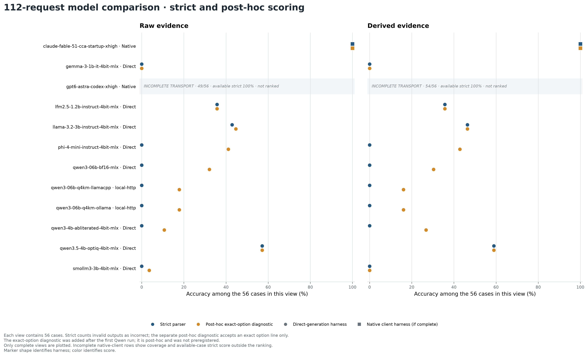
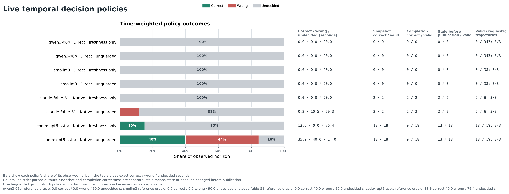
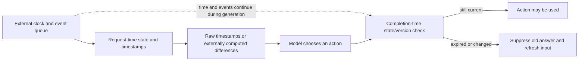

# TickLM temporal benchmark: what we measured

**Measured 3 November 2026. Report data generated 2026-11-03. Experimental, synthetic, and not a state-of-the-art ranking.**

On the simple static questions, frontier-client replies were often correct when the strict parser accepted them. The live runs exposed a different problem: response formatting and delay can make an answer unusable after the state changes. This does not show that a model cannot understand time. The clock and event state live in the harness. In these runs, models receive time readings rather than measuring elapsed wall time themselves.

The retained static runs contain **2,436 scheduled prompt attempts** across 21 run records and **19 unique system IDs**. The largest frozen case set has **448 cases**. In this release the 112-case and 28-case tiers are exact subsets of the 448-case full set; the saved case IDs were checked. Across tiers, the report contains 2,436 result rows, 15 failed replies, and 0 missing replies. These attempts repeat cases across systems; they are not new independent cases.

## At a glance

| Requests per run | Runs | Recorded / scheduled attempts | Client failures | Missing | Invalid answer format |
|---:|---:|---:|---:|---:|---:|
| 112 | 12 | 1,344/1,344 | 9 | 0 | 786 |
| 448 | 2 | 896/896 | 0 | 0 | 896 |
| 28 | 7 | 196/196 | 6 | 0 | 32 |

There are **3 frozen dataset hashes** and **19 unique system/harness IDs**. The same Qwen3-0.6B and SmolLM3 system IDs appear in both screen and full tiers; those are repeated runs on more cases, not additional model configurations.

[Detailed coverage, family, and latency tables](<results.md>) are generated from the same saved run records.

## Static model runs

The suite is four-choice synthetic English. Each case has a raw-facts view and a derived-facts view; the derived prompt supplies primitive arithmetic where applicable. The model chooses a labelled answer from those supplied facts. It is not asked to run a clock or fetch time.

### 112-request screening tier

Each system received the same 112-request screen: 56 raw-timestamp cases and 56 derived-value cases. The screen is a subset of the full frozen suite.

| Requested model | Harness | Raw: correct / scheduled | Derived: correct / scheduled | Failed or missing (raw / derived) | Invalid format (raw / derived) |
|---|---|---:|---:|---:|---:|
| claude-fable-5-1 | Claude Code | 56/56 | 56/56 | 0 / 0 | 0 / 0 |
| mlx-community/gemma-3-1b-it-4bit | MLX | 0/56 | 0/56 | 0 / 0 | 56 / 56 |
| gpt-6-astra | Codex | 49/56 | 54/56 | 7 / 2 | 0 / 0 |
| mlx-community/LFM2.5-1.2B-Instruct-4bit | MLX | 20/56 | 20/56 | 0 / 0 | 0 / 0 |
| mlx-community/Llama-3.2-3B-Instruct-4bit | MLX | 24/56 | 26/56 | 0 / 0 | 2 / 0 |
| mlx-community/Phi-4-mini-instruct-4bit | MLX | 0/56 | 0/56 | 0 / 0 | 56 / 56 |
| Qwen/Qwen3-0.6B | MLX | 0/56 | 0/56 | 0 / 0 | 56 / 56 |
| qwen3-0.6b-q4 | llama.cpp | 0/56 | 0/56 | 0 / 0 | 56 / 56 |
| qwen3:0.6b | ollama | 0/56 | 0/56 | 0 / 0 | 56 / 56 |
| huihui-ai/Qwen3-4B-abliterated | MLX | 0/56 | 0/56 | 0 / 0 | 56 / 56 |
| mlx-community/Qwen3.5-4B-OptiQ-4bit | MLX | 32/56 | 33/56 | 0 / 0 | 0 / 0 |
| mlx-community/SmolLM3-3B-4bit | MLX | 0/56 | 0/56 | 0 / 0 | 56 / 56 |

**Post-hoc exact-option diagnostic** (correct / completed; invalid):

| System ID | Raw option-line diagnostic | Derived option-line diagnostic |
|---|---:|---:|
| claude-fable-51-cca-startup-xhigh | 56/56 (invalid 0) | 56/56 (invalid 0) |
| gemma-3-1b-it-4bit-mlx | 0/56 (invalid 56) | 0/56 (invalid 56) |
| gpt6-astra-codex-xhigh | 49/49 (invalid 0) | 54/54 (invalid 0) |
| lfm2.5-1.2b-instruct-4bit-mlx | 20/56 (invalid 0) | 20/56 (invalid 0) |
| llama-3.2-3b-instruct-4bit-mlx | 25/56 (invalid 0) | 26/56 (invalid 0) |
| phi-4-mini-instruct-4bit-mlx | 23/56 (invalid 4) | 24/56 (invalid 1) |
| qwen3-06b-bf16-mlx | 18/56 (invalid 7) | 17/56 (invalid 5) |
| qwen3-06b-q4km-llamacpp | 10/56 (invalid 29) | 9/56 (invalid 28) |
| qwen3-06b-q4km-ollama | 10/56 (invalid 29) | 9/56 (invalid 28) |
| qwen3-4b-abliterated-4bit-mlx | 6/56 (invalid 40) | 15/56 (invalid 29) |
| qwen3.5-4b-optiq-4bit-mlx | 32/56 (invalid 0) | 33/56 (invalid 0) |
| smollm3-3b-4bit-mlx | 2/56 (invalid 54) | 0/56 (invalid 56) |

### 448-request full tier

Each full run covers 224 raw-timestamp cases and 224 derived-value cases from the 448-case frozen suite.

| Requested model | Harness | Raw: correct / scheduled | Derived: correct / scheduled | Failed or missing (raw / derived) | Invalid format (raw / derived) |
|---|---|---:|---:|---:|---:|
| Qwen/Qwen3-0.6B | MLX | 0/224 | 0/224 | 0 / 0 | 224 / 224 |
| mlx-community/SmolLM3-3B-4bit | MLX | 0/224 | 0/224 | 0 / 0 | 224 / 224 |

**Post-hoc exact-option diagnostic** (correct / completed; invalid):

| System ID | Raw option-line diagnostic | Derived option-line diagnostic |
|---|---:|---:|
| qwen3-06b-bf16-mlx | 73/224 (invalid 38) | 74/224 (invalid 28) |
| smollm3-3b-4bit-mlx | 4/224 (invalid 220) | 0/224 (invalid 224) |

### 28-request model/client check

Each small check has 14 raw-timestamp and 14 derived-value cases. That is seven counterfactual pairs per view, so small differences are highly uncertain.

| Requested model | Harness | Raw: correct / scheduled | Derived: correct / scheduled | Failed or missing (raw / derived) | Invalid format (raw / derived) |
|---|---|---:|---:|---:|---:|
| claude-haiku-5-5 | Claude Code | 14/14 | 14/14 | 0 / 0 | 0 / 0 |
| claude-opus-5-5 | Claude Code | 13/14 | 14/14 | 0 / 0 | 1 / 0 |
| claude-sonnet-5-5 | Claude Code | 11/14 | 13/14 | 0 / 0 | 3 / 1 |
| gpt-6-luna | Codex | 11/14 | 13/14 | 2 / 0 | 0 / 0 |
| gpt-6.1-sol | Codex | 14/14 | 13/14 | 0 / 1 | 0 / 0 |
| gpt-6.1-terra | Codex | 12/14 | 14/14 | 2 / 0 | 0 / 0 |
| ollama/qwen3:0.6b | OpenCode + Ollama | 0/14 | 0/14 | 1 / 0 | 13 / 14 |

**Post-hoc exact-option diagnostic** (correct / completed; invalid):

| System ID | Raw option-line diagnostic | Derived option-line diagnostic |
|---|---:|---:|
| claude-haiku-55-cca-startup-xhigh | 14/14 (invalid 0) | 14/14 (invalid 0) |
| claude-opus-55-cca-startup-xhigh | 13/14 (invalid 1) | 14/14 (invalid 0) |
| claude-sonnet-55-cca-startup-xhigh | 11/14 (invalid 3) | 13/14 (invalid 1) |
| gpt-6-luna-codex-xhigh | 11/12 (invalid 0) | 13/14 (invalid 0) |
| gpt-6.1-sol-codex-xhigh | 14/14 (invalid 0) | 13/13 (invalid 0) |
| gpt-6.1-terra-codex-xhigh | 12/12 (invalid 0) | 14/14 (invalid 0) |
| qwen3-06b-q4km-opencode-ollama | 3/13 (invalid 7) | 2/14 (invalid 8) |

**Reading these tables:** the short tables show `strictly correct / scheduled questions`, so missing and failed requests cannot inflate the visible fraction. This is delivered task success, not pure reasoning accuracy. The detailed tables separately score completed replies, coverage and both-correct counterfactual pairs. Invalid response formats count wrong. The 28-request tier has only seven pairs per view. Direct runs request a 256-token cap; native clients do not enforce that cap. Claude Code and Codex request xhigh effort; OpenCode does not expose a verified effort setting.

The exact-option diagnostic was added after the first Qwen run showed that some models answered with a whole option line such as `A. ALARM` instead of a bare letter. It was applied uniformly to all systems, but it is **post-hoc and was not preregistered**. It does not replace or edit the primary strict score.

Some full-tier small-model runs have strict accuracy of 0/224 in each view while all 224 completed replies are strict-invalid. That is a format/parser result, not evidence that those models have zero temporal ability. The separate exact-option diagnostic makes some whole-option replies scoreable; it does not change the model text or turn a wrong choice into a correct one.

## Live event timing

The live test uses three real-clock 30-second trajectories per system, with scripted events. The harness records actual elapsed time, including any overrun, and an external timestamped state for each request. An event clock keeps advancing while a model is generating; the model does not receive events that arrive after its prompt was sent.

| System / model | Adapter | Requests | Trajectories / observed time | Snapshot correct / valid | Correct at completion / valid | Stale before publication / valid |
|---|---|---:|---:|---:|---:|---:|
| **claude-fable-5-1** claude-fable-51-cca-startup-xhigh | claude_code · native-client | 6 | 3 × 30s (90.0s) | 2/2 | 2/2 | 2/2 |
| **gpt-6-astra** gpt6-astra-codex-xhigh | codex · native-client | 19 | 3 × 30s (90.0s) | 18/18 | 9/18 | 13/18 |
| **Qwen/Qwen3-0.6B** qwen3-06b-bf16-mlx | mlx · direct-generation | 343 | 3 × 30s (90.0s) | 0/0 | 0/0 | 0/0 |
| **mlx-community/SmolLM3-3B-4bit** smollm3-3b-4bit-mlx | mlx · direct-generation | 38 | 3 × 30s (90.0s) | 0/0 | 0/0 | 0/0 |

A response can be correct for its request snapshot and already be outdated when generation finishes. That is not a semantic reasoning error and does not prove that a model cannot understand time: the new event was unseen by the model. No model can react to an event it has not received; the controller has to refresh the prompt or suppress the old output. The report therefore separates snapshot correctness, correctness at completion, and state/deadline changes before publication.

The *freshness-only* rule tracks state versions and deadlines; it suppresses stale output but does not judge whether the model chose the right action. *Unguarded* keeps the last model action active. The *oracle-guarded* calculation uses the correct answer and is a non-deployable reference. Guard behavior is deterministic harness logic; it is not model capability.

### Offline output-format replay

Post-hoc after Qwen format failures: offline parser counterfactual at original recorded publication times, assuming zero extra parser time. No new inference or live intervention.

| System / score mode | Attempts | Accepted / invalid / failed | Snapshot correct / wrong | Freshness-only correct / wrong / undecided (seconds) | Unguarded correct / wrong / undecided (seconds) |
|---|---:|---:|---:|---:|---:|
| claude-fable-5-1 · Strict parser | 6 | 2 / 4 / 0 | 2 / 0 | 0.0 / 0.0 / 90.0 | 0.2 / 10.5 / 79.3 |
| claude-fable-5-1 · Post-hoc exact-option parser | 6 | 2 / 4 / 0 | 2 / 0 | 0.0 / 0.0 / 90.0 | 0.2 / 10.5 / 79.3 |
| gpt-6-astra · Strict parser | 19 | 18 / 0 / 1 | 18 / 0 | 13.6 / 0.0 / 76.4 | 35.9 / 40.0 / 14.0 |
| gpt-6-astra · Post-hoc exact-option parser | 19 | 18 / 0 / 1 | 18 / 0 | 13.6 / 0.0 / 76.4 | 35.9 / 40.0 / 14.0 |
| Qwen/Qwen3-0.6B · Strict parser | 343 | 0 / 343 / 0 | 0 / 0 | 0.0 / 0.0 / 90.0 | 0.0 / 0.0 / 90.0 |
| Qwen/Qwen3-0.6B · Post-hoc exact-option parser | 343 | 339 / 4 / 0 | 226 / 113 | 56.0 / 28.8 / 5.2 | 58.5 / 29.3 / 2.2 |
| mlx-community/SmolLM3-3B-4bit · Strict parser | 38 | 0 / 38 / 0 | 0 / 0 | 0.0 / 0.0 / 90.0 | 0.0 / 0.0 / 90.0 |
| mlx-community/SmolLM3-3B-4bit · Post-hoc exact-option parser | 38 | 0 / 38 / 0 | 0 / 0 | 0.0 / 0.0 / 90.0 | 0.0 / 0.0 / 90.0 |

The alternate parser accepts the frozen strict format or one exact whole option line. It reuses the original recorded request and publication times and assumes zero extra parser latency. It is a diagnostic of response formatting plus choice, not a new model trial.

### What the clock supplies

For example, a development prompt gives **Start = 107.25 seconds** and **Now = 112.75 seconds**. The correct difference is `112.75 − 107.25 = 5.50 seconds`, below the **5.75-second threshold**, so the answer is “wait.” In the raw view the model must subtract the supplied timestamps; in the derived view the program supplies the difference. This is a development example, not a measured live interval. In the live test, Python `time.monotonic()` records points A and B and the program calculates `B − A`; the model interprets that elapsed time and the latest supplied event. TimesFM and Bekko were not used to calculate these times or generate answers in this benchmark. Their earlier forecasting and decision experiments are separate.

## How to interpret the results

The static task is deliberately simple. High accuracy on accepted static responses shows that a system can answer these supplied-fact questions; it does not establish broad temporal reasoning, numerical extrapolation, or general instruction following. A correct snapshot answer can become useless after a long response or a new event. In the live test, the important failures separate into answer formatting, decision quality at the snapshot, and freshness at completion.

Models and harnesses did not receive equal compute. Direct MLX generation used local checkpoints on an Apple M4 Max with 36 GB memory; checkpoint sizes and quantization differ. Claude Code and Codex ran through existing signed-in clients with their own prompts and transport. Their 256-token request was not an enforced hard cap; effort such as `xhigh` is a requested client setting, not independent evidence of internal compute. The local HTTP Ollama route is reported as its own adapter. Observed latency is illustrative: one host ran local models, native clients, and other CPU work, so it is not a controlled speed ranking.

No direct metered provider API calls were charged to the separate $25 budget. Native client usage came through pre-existing sign-ins; subscription consumption is not equated with zero cost here. No option-order variants were run. These are small, single-run samples with a few complete counterfactual pairs, especially in the 28-request tier; confidence intervals and zero-width intervals should not be read as seed or deployment uncertainty.

The evidence supports a modest engineering point: keep the clock and event state outside the model, let a model choose among supplied actions when useful, and use a deterministic freshness gate before acting on its answer. It does not show that a weight update is necessary; a fast deterministic policy remains the right baseline for rules that can be stated exactly.

## Related published work

This synthetic suite is not a replacement for existing temporal benchmarks and has no official leaderboard score. No TickLM model in this report was evaluated on these external datasets. The primary papers ask related but different questions:

- [TIME: A Multi-level Benchmark for Temporal Reasoning of LLMs in Real-World Scenarios](https://arxiv.org/abs/2505.12891) studies temporal questions from wiki, news, and dialogue.
- [MultiTempBench](https://arxiv.org/abs/2603.19017) examines date arithmetic, time-zone conversion, and temporal relations across languages and calendar formats.
- [TRACE](https://arxiv.org/abs/2607.04784) generates interval-constraint tasks with controlled difficulty and trace verification.
- [StreamDecisionBench](https://arxiv.org/abs/2609.38612) measures whether a decision remains correct while language streams evolve and answers arrive late.
- [AgentTime](https://arxiv.org/abs/2610.09944) tests agent runtime estimation, duration following, and control in native agent harnesses.

A separate offline check reproduced **54.105400773%** normalized log-area-under-curve from one existing StreamDecisionBench author recording. That is the upstream recording’s scorer result, not a TickLM model score or a score from this synthetic suite; no new model inference was used for it. See the [external validation notes](<../../docs/benchmark-external-validation.md>).

## Reproducibility and source data

Input report generated 2026-11-03. Static results are grouped by frozen dataset hash and system ID; the report input contains 3 dataset hashes. The full JSON and per-run tables retain coverage, model aliases, and parser outputs.

- Input report: `results.json`
- Offline replay: `replay.json`; SHA-256 `3b6ac8d9bd1dc774c3486373ee8c2ff6fee55c0a93f30c3c74d56adc17e3a77b`.
- Machine-readable run summaries and detailed tables: [results JSON](<results.json>) and [results Markdown](<results.md>).
- Largest frozen tier: 448 cases; the smaller tiers are exact subsets in this release.
- System IDs represented: `claude-fable-51-cca-startup-xhigh`, `claude-haiku-55-cca-startup-xhigh`, `claude-opus-55-cca-startup-xhigh`, `claude-sonnet-55-cca-startup-xhigh`, `gemma-3-1b-it-4bit-mlx`, `gpt-6-luna-codex-xhigh`, `gpt-6.1-sol-codex-xhigh`, `gpt-6.1-terra-codex-xhigh`, `gpt6-astra-codex-xhigh`, `lfm2.5-1.2b-instruct-4bit-mlx`, `llama-3.2-3b-instruct-4bit-mlx`, `phi-4-mini-instruct-4bit-mlx`, `qwen3-06b-bf16-mlx`, `qwen3-06b-q4km-llamacpp`, `qwen3-06b-q4km-ollama`, `qwen3-06b-q4km-opencode-ollama`, `qwen3-4b-abliterated-4bit-mlx`, `qwen3.5-4b-optiq-4bit-mlx`, `smollm3-3b-4bit-mlx`.
- External scorer reproduction, input checks, and limitations: [benchmark external validation](<../../docs/benchmark-external-validation.md>).
