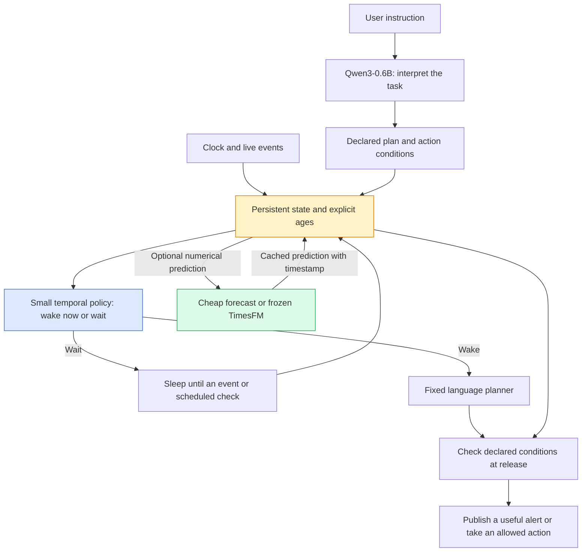

**TickLM: what we should build next**

Research cutoff: **3 November 2026**. The clock returned 2026-11-03 04:31:16 UTC; the local clock returned 10:01:16 IST. This is a targeted review of primary research available year to date, including relevant revised versions. It is not an exhaustive systematic review or a claim that one model leads every task. Paper results below are the authors' reports, not replications by this project.

**Recommendation.** Build a small temporal decision layer that learns when waking a language model is likely to produce a useful result before the situation changes. Keep TickLM's clock, event storage, and machine-checkable release conditions. Use the existing 17M Bekko model as one candidate for the learned layer; compare it with a much smaller feature-based network. Add TimesFM only after showing that numerical predictions improve timely decisions. Keep Qwen3-0.6B as the proposed local language component and a single-pass decision baseline. A unified 0.6B checkpoint is a later research stage.

The working name for this extension is **TickLM Pulse**. This name describes a proposed extension, not an implemented model or a verified unique product name.

**What the existing project establishes**

The [frontier trials](frontier-results.md) establish that the controller can keep receiving events and handle deadlines while Claude Code or Codex produces text. Each of the four scripted runs answered all four graded questions correctly. Claude published three of those four answers in each run; Codex published two. Those were single runs with different realized input streams, not a controlled model ranking. The model reported clock values supplied by Python.

The original [local trial](live-results.md) ran for 24.69 seconds after warmup and received 201 simulated readings. Those readings are not 201 independent experiments. There is no retained evidence of a 21-minute timeout. TimesFM exercised a real forecast-to-wake path; neither improved forecasting nor reduced total compute was established.

The current six-second response expiry and observation-version rules can also reject answers that remain historically true. Before the next model experiment, define validity by the claim or action: a past observation, a current-state assertion, and an executable action require different checks. Give every policy the same corrected runtime so it receives no credit for this software improvement.

**The research that changes the design**

Dates are first arXiv submissions unless a revision is explicitly listed. Full text means selected relevant sections were inspected by this research panel, not a complete audit of every proof or experiment.

| Paper and date | Relevant evidence | Implication and boundary |
|---|---|---|
| [Do Proactive Agents Need an LLM to Decide When to Act?](https://arxiv.org/abs/2605.30152), 28 May; revised 28 September 2026. Full text. | A temporal graph controller handles triggering and context selection. Its 1.16M trainable parameters accompany a frozen 109M text encoder. | Small-model wake-up control is established prior art. Count frozen weights and encoding cost too. This study does not establish our proposed behavior under changing action validity during generation. |
| [Finding the Time to Think: Learning Planning Budgets in Real-Time RL](https://arxiv.org/abs/2606.26463), 24 June 2026. Full text. | A learned gate chooses planning budgets while the environment advances. | Explicitly price inference delay. Its game-planning setting and simulator assumptions differ from a language agent receiving asynchronous events. |
| [TimeInteract](https://arxiv.org/abs/2609.26389), 22 September 2026. Full text. | Separates a continuing control stream from response generation and learns when to respond. | Streaming control is also prior art. Our question concerns timely valid action under real serving delays, not simply concurrent streams. |
| [SpaTime: Streaming Vision-Language Models for Spatio-temporal Reasoning](https://arxiv.org/abs/2610.08713), 6 October 2026. Full text. | Trains first-response timing in a causal streaming visual task. | Learning when to respond is not new. Its visual question-answering task does not settle asynchronous instruction changes and release validity. |
| [Realtime-Bench: Can Frontier Models Solve Real-time Interactive Problems?](https://arxiv.org/abs/2610.22155), 15 October; revised 22 October 2026. Full text. | Evaluates interactive tasks with paused, wall, and token clocks. | Evaluate while the world moves. A token clock is a standardized proxy, not measured inference latency. |
| [ASPEN: Adaptive Semantic Reasoning via Command Persistence Prediction for Efficient Navigation VLAs](https://arxiv.org/abs/2610.36285), 26 October 2026. Full text. | Predicts when an existing command can be reused; reports 9.5% fewer calls and 8.1% less estimated inference time, including scheduler overhead. | Plan persistence is a useful prediction target with close prior art. Results apply to eligible navigation command boundaries, not our arbitrary live events. |
| [LLM-as-Jev: LLMs Are Already Jev-Style Decision Models -- When and How to Fine-Tune Them](https://arxiv.org/abs/2610.02076), 1 October; revised 13 October 2026. Abstract and selected full-text findings. | Studies decision readouts and fine-tuning, including Qwen3-0.6B. | A one-pass Qwen choice head is an essential baseline. A broad decision benchmark does not establish temporal behavior. |
| [Releasing the Inner Jev: A Simple Recipe for Open Decision Models](https://arxiv.org/abs/2610.17205), 12 October 2026. Abstract and selected full-text findings. | Studies language-model choice logits and fine-tuned decision heads. | A decision head is an established mechanism; adding one is not itself a research contribution. |
| [System Switch: When Should a Fast Decision Model Stop and Think?](https://arxiv.org/abs/2610.09683), 7 October 2026. Abstract. | Offline deferral helps, but none of the tested variants reaches the exit in 33 closed-loop games. | Offline choice accuracy and confidence-based routing do not establish working behavior over time. |
| [Fast Models, Slow Evidence](https://arxiv.org/abs/2610.02267), 1 October 2026. Full text. | Audits paired decision-model evaluations, gate costs, and threshold selection. | Charge every gate and forecast; choose thresholds outside the final test set. |
| [Chronicle: A Multimodal Foundation Model for Joint Language and Time Series Understanding](https://arxiv.org/abs/2605.20268), 18 May 2026. Full text. | A 324M shared backbone learns language and numerical representations; the authors describe a representation backbone rather than a conversational agent. | Small unified models are plausible and already researched. This does not show that our three checkpoints can be cheaply merged without losing capabilities. |
| [Lapras: Latent Reasoning for Time Series Language Models](https://arxiv.org/abs/2610.11111), 8 October 2026. Abstract. | Teacher-student post-training transfers text reasoning into continuous representations for time-series question answering. | Latent fusion and distillation have relevant precedents. Fewer generated tokens alone do not establish lower total compute or real-time agency. |

The [System 1 models guide](https://arxiv.org/abs/2610.33775), first submitted 24 October and revised 29 October 2026, is a useful taxonomy and calibration reference. It is a survey, not evidence that the local Bekko checkpoint succeeds on this task. Searches also checked for relevant November submissions through the cutoff; search coverage is not a guarantee that every new paper was indexed.

**Four possible builds**

| Build | Main advantage | Main cost or research risk | Decision |
|---|---|---|---|
| Deterministic temporal plans with optional forecasts | Simple, interpretable baseline; clocks, thresholds, acknowledgments, and deadlines are explicit | Limited ability to recognize unfamiliar semantic situations or choose computation under uncertainty | Build first as the control condition |
| Small learned temporal policy beside frozen specialists | Can learn timing from state, goals, and measured completion delays while avoiding repeated generation | May add nothing beyond rules or a tiny feature head | Recommended research direction |
| TimesFM representations projected into Qwen | Can train the language model to use temporal features directly | Alignment requires training; repeated language-model execution may dominate cost | Later representation experiment |
| One approximately 0.6B student with language, time-series, and decision heads | Potentially one compact deployed checkpoint | Highest training burden and risk of losing teacher abilities | Only after identifying capabilities worth compressing |

Literal weight averaging cannot combine these different architectures into one model. The three-model system has Qwen's parameters plus Bekko's parameters plus TimesFM's parameters and any adapters. Frozen parameters still occupy memory and consume inference compute.

**The proposed architecture**

The first learned policy has a deliberately narrow output: **wake now, or wait for a specified interval**. A new event can interrupt that wait. A separate deadline timer remains active, and the runtime schedules a lead-time wake using a calibrated upper completion-latency estimate. Starting generation at the deadline is already too late. If insufficient time remains, use an already authorized immediate action or record a missed opportunity; do not begin a call and count its eventual answer as timely. A latency estimate cannot guarantee completion. Reforecasting and choosing a reasoning budget are later additions, not extra moving parts in the first experiment.

Its inputs are the declared goal, observed event history, explicit elapsed time, time since the last observation, remaining deadline, cached forecast age, and measured latency information for the selected language backend. Missingness and source-event time are distinct from arrival time. A new arrival must not reset a source-age field incorrectly. The state continues to age during silence without repeatedly calling a neural network.

The 17M candidate is the existing **Railhead fine-tune of Bekko System One**, with **16,798,211 parameters** and a native MLX implementation. It is not the OpenJev checkpoint. Its game-route policy is not automatically a temporal policy. Compare the base Bekko and Railhead initialization if adaptation warrants that expense. The first training target can be a small network over explicit features; Bekko must demonstrate that its text representations add value.

Bekko exposes 256-dimensional candidate representations. TimesFM's internal width is 1,280. These interfaces make a later projection feasible, but matching vector sizes does not align their meanings. Start with interpretable forecast outputs. If a latent connector is tested, use a learned interaction with the candidate action: a shared additive linear forecast term cancels in a softmax over candidates. Keep both backbone changes and representation changes separate in the comparisons.

A useful learned target is **how long the present plan is likely to remain appropriate**, conditioned on its goal and the predicted completion time of the next computation. This is an estimate, not a validity guarantee. Exact release checks apply to dependencies declared in a machine-checkable plan. Arbitrary natural-language claims cannot acquire reliable dependency checks merely by attaching a version number.

Validation uses a consistent state snapshot. A local side effect needs an atomic or version-conditional check-and-commit; remote actions need an explicit validity boundary and idempotency key, with any unclosed race reported. Define how late events affect known state and historical corrections. An arrival-order version identifies a snapshot but does not prove event-time truth. Score the plan compiler's missing and spurious dependencies separately from the scheduler.

The central hypothesis is: on held-out streams, conditioning wake decisions on elapsed time, changing state, and measured backend delay can improve correct alerts delivered while they remain useful, at the same total compute budget. This combines established ideas. Global novelty is not established.

**The first experiment**

Use a monitored job as a concrete showcase: “Watch this job. Alert me if it is likely to miss its deadline. Recheck after a prolonged lack of progress. Stop if it finishes, I acknowledge the alert, or I cancel monitoring.” Include numeric progress and symbolic events that replace or cancel the instruction.

Start by measuring headroom: compare the strongest tuned rule with a simulator policy that can see future events and realized inference delays, under the same action and call-budget constraints. This is an unattainable reference bound, not a deployable baseline. If the achievable gap is too small to matter, improve the task or stop before training a neural controller.

Begin with exact alert conditions and known validity windows. Add the probabilistic “likely to miss” condition in the forecast stage, with an explicit cost of missed and false alerts and a declared probability threshold. Its ground truth is the simulator's conditional event probability given available history, estimated with fresh conditional rollouts where necessary, not hidden parameters exposed to the policy. A realized late completion alone does not establish whether an earlier probability was well calibrated. For real logs, report observable realized utility and calibration over many cases; counterfactual decisions require additional causal assumptions.

Hold the language planner, plan schema, state representation, and release checks fixed. Compare fixed-interval polling, tuned deterministic event/deadline rules, a small feature-based classifier, adapted Bekko 17M, and a Qwen3-0.6B single-pass choice policy. A no-neural-model path must be able to issue templated alerts for machine-checkable conditions. Otherwise the benchmark could manufacture a need for language inference.

All policies receive the same available history, event notifications, timer/deadline interrupts, latency estimates, and allowed immediate actions. Fixed-interval polling ignores optional notifications by policy choice. Give models comparable development and threshold-selection opportunities and report training costs separately. If the learned model depends on residual free text, give that text to the competing semantic policies too. Compare Bekko base, Railhead fine-tune, and an architecture-equivalent random initialization when claiming pretrained transfer; retain whichever initialization earns its place rather than assuming the game fine-tune is preferable.

First keep forecast information identical across policies. Then compare no forecast, a cheap numerical predictor, and frozen TimesFM under the same selected policy. Finally, if TimesFM helps, compare its forecast values with learned latent features. Include an equivalent small controller trained from scratch to test whether pretrained Bekko representations contribute.

Construct matched cases with the same values but different elapsed time; silence versus arriving evidence; reversed event order; changed versus unchanged goals; useful versus irrelevant new events during generation; irregular sampling; and late, duplicated, or out-of-order arrivals. Include durable historical claims so an always-reject policy is exposed. Use harmless changes to measure over-invalidation, not only changes that demand cancellation.

Training uses current-prefix features only. Simulator branch outcomes may supply labels for alternative wake times, but future information is never an input. Labels must measure the outcome after the simulated model response finishes; ordinary snapshot labels ignore the central problem. Score outcome validity against independent simulator truth, not the guard's accept/reject verdict. Sample completion delays from recorded backend distributions and stress-test shifts outside the training range. A forecast's marginal quantiles are not a calibrated probability of any threshold crossing over a time interval. If first-passage probabilities are needed, train and evaluate an explicit event-by-horizon head or a justified trajectory model.

Split whole episodes and process families, with separate training, calibration, development, and untouched test sets. Hold out instruction patterns as well as numerical generators. Fix candidate operating thresholds and budget weights before the final evaluation. Count episodes rather than treating adjacent samples as independent. Report paired episode-level uncertainty.

Virtual time is useful for inexpensive training and broad screening. A final test must replay events against real running local and frontier models while the clock advances. Offline trajectories alone cannot show closed-loop success when actions change future observations. For that setting use an interactive simulator with shared exogenous seeds; do not claim policies experienced identical resulting states.

Measure correct alerts delivered before their opportunity expires, missed alerts, false alerts, invalid releases, and unnecessary wake-ups. Report silence-driven alerts separately. Charge tokenization, prefill, policy inference, forecasts, interrupted requests, and language generation. Report wall-clock response distributions, resident and peak memory, startup cost, and idle compute. Cloud token billing and local device time are separate quantities; do not combine them into an unexplained universal cost number. Measure energy only if suitable instrumentation is available.

Run blanket expiry versus dependency-aware validity as a separate comparison with identical policies. Show the policy effect inside each validity condition. Otherwise a runtime correctness fix could be misreported as learned temporal intelligence.

**What would make us stop or advance**

- Keep the learned scheduler only if it improves timely useful alerts over the strongest matched-budget baseline without a worse invalid-release rate. Choose a practically meaningful improvement margin on development data and fix it before the final test; report uncertainty, not just a point estimate.
- Keep Bekko only if it adds useful quality or generalization over the small feature-only network after counting its full cost. The existence of a checkpoint is not a reason to retain it.
- Keep TimesFM only if its removal worsens downstream decisions enough to justify forecasting cost. If the cheap predictor matches it, ship the cheap predictor for that task.
- Do not claim success when the system avoids all errors by staying silent. Missed opportunities are a primary endpoint.
- A result on this narrow task supports temporal control for this task distribution. Broader claims require a second domain and held-out live conditions.

**A path to a genuinely compact temporal language model**

If the teacher system wins, distill its observable behavior into Qwen3-0.6B with explicit elapsed-time and missingness inputs, numerical patch inputs, a decision/timing head, and the language output head. Add a forecasting objective only for predictive abilities that the downstream experiment shows are useful. Use adapted backbone weights as well as input/output projections if a frozen backbone cannot learn the required interactions; rehearse language tasks to measure and limit lost capability.

Supervise duration counterfactuals, event ordering, no-event intervals, changing goals, and response validity at completion. Measure language quality, numerical prediction, and temporal decisions separately. A student that explains an elapsed-time number but cannot change its action when that duration changes has not met the objective. The system still needs an actual clock and persistent state outside a forward pass.

This is a training and evaluation program, not a promise that all specialist capabilities will fit in 0.6B parameters. The credible first milestone is a working temporal policy with a measured benefit; compression follows evidence about what needs preserving.

**Research review and implementation status**

Two Terra reviewers and one Luna reviewer examined real-time agents, representation fusion, and decision models at requested xhigh effort. A separate critique completed through the existing Claude Code adapter using `cca startup`: Claude Code 2.1.317, requested and resolved model **claude-fable-5-1**, requested effort **xhigh**, client-observed completion time **291.53 seconds**. This was research review, not a temporal benchmark. The effort flag records the request, not independently measured internal computation. Fable received a primary-source evidence packet with browsing disabled; it did not independently retrieve papers. See the [review, exact input, and runtime metadata](../evidence/research-panel-20261103/fable-review.json).

Fable's most useful corrections were to measure oracle-versus-rule headroom before training, treat Bekko and TimesFM as hypotheses rather than required components, evaluate silence explicitly, and score publication against independent ground truth. We retained downstream useful-alert utility as the TimesFM selection criterion: calibration improvement and a compute ratio have different units and should not be compared directly. A Terra review also corrected deadline lead time, atomic action validation, forecast-label definitions, and equal baseline access.

The adapter's probe interface records a nominal requested maximum of eight tokens, but explicitly reports that this limit is not enforced by the CLI. The research prompt requested a bounded written review; the returned usage includes substantially more output. This was not an eight-token experiment or a measured token-saving result. The sanitized evidence preserves that limitation.

This document proposes the next build. No learned temporal policy, new 0.6B model, or fusion training was performed in this research turn. Existing experimental results remain those linked above.
