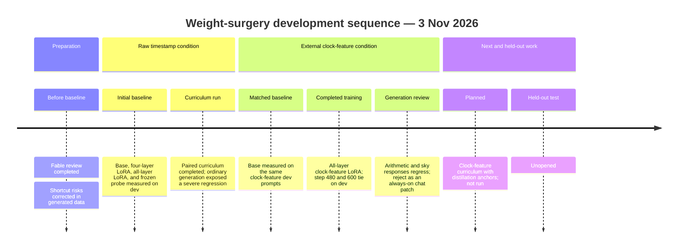

# Qwen3 temporal weight-surgery journey

- **Date:** 3 November 2026
- **Branch:** `experiment/temporal-weight-surgery`
- **Updated through:** 2026-11-03 06:40 UTC
- **Status:** The clock-feature LoRA run is complete. Its high development score did not survive the ordinary-generation review, so it is rejected as an always-on chat patch. The held-out test set remains unopened.



This log records the research and attempts so far, including unsuccessful ones. Raw artifacts and adapter checkpoints remain in the locally ignored `artifacts/weight-surgery-20261103/` directory. The compact [run index](../evidence/weight-surgery-20261103/journey-index.json) maps each explicit run ID to its local evidence and source hashes. Safe evidence archives are listed below. No model weights have been uploaded.

## Research review and checkpoint identity

Before training, a Claude review was run with requested and resolved model `claude-fable-5-1` at `xhigh` effort. The saved JSON records `elapsed_s: 204.97264645798714` (204.97 seconds) and estimated cost `$1.00581875`. The prompt requested at most 650 words. Separately, wrapper metadata records `requested_max_tokens: 8` and `max_tokens_enforcement: not_enforced`; this was not a prompt instruction and did not constrain the response. The review is recorded model feedback, not independent research verification. Its prompt and response remain in `artifacts/weight-surgery-20261103/fable-plan-prompt.txt` and `fable-plan-review.json`.

The local checkpoint is `models/qwen3-0.6b-bf16-c1899de`; run manifests record revision `c1899de289a04d12100db370d81485cdf75e47ca`, supplied by the caller. MLX reports 596,049,920 loaded parameters. The checkpoint files contain 751,632,384 stored tensor elements, including tied or duplicated tensors; that is not the active parameter count.

## Data corrections and raw-input baseline

Before the original baseline, the generated benchmark was red-teamed and corrected to vary fractional margins on both sides of decision boundaries, include equality only for a subset of positives, separate relevant events from mismatched or earlier events, and balance reset presence across sustained-condition outcomes. Pair members retain the same choices and differ in one input. These generated cases test rule-following; they do not establish that an LLM is needed for these decisions.

The original raw-input development set contains 256 cases and has SHA-256 `32e346074349a11f3db710adfc672c162e14f21c653c6eee1868126c0f518656`. The initial 1,024-case training set hash is `44e947dc2d6792c5bbe0b91e686bcc95e9f047a63bae97c337b625466ce502e8`. Public rendering and robustness helpers later changed the source hash without changing that saved dev data. The train-only curriculum created a new training set, hash `e053a80c29c82772c3e98a9a4113ad4a873d32c3f9889614ac4bd2036fa803ec`, while keeping the original dev set unchanged.

The unmodified base scored **37.890625%** item accuracy and **0.78125%** pair-both-correct accuracy on raw-input dev. The deterministic reference scored 100% on these generated labels. A separate base-generation smoke run on three fixed prompts is retained for later comparison.

## Raw-input adaptation attempts

`lora4-choice-s1103` used rank-8 LoRA on query/value projections in the last four layers, choice-only cross-entropy, learning rate `3e-4`, batch size 4, seed 1103, and 160 steps on 1,024 training cases. It exposed 163,840 trainable parameters, **0.02749%** of the loaded count. The suggested checkpoint, step 96, scored **41.40625%** item accuracy and **0.78125%** pair-both-correct, unchanged from base. The retained non-temporal dev smoke set scored 41.67%; adapter reload parity had maximum logit difference zero. The paired endpoint did not improve, so this run does not support a temporal-reasoning claim.

`lora28-full-s1103` trained rank-8 query/value LoRA in all 28 layers for 600 steps with full-vocabulary loss, learning rate `3e-4`, batch size 8, and multiple-choice retention anchors every five steps. It trained 1,146,880 parameters (**0.1924%**). The CLI suggested step 240: **51.171875%** item accuracy, **2.34375%** pair-both-correct, and 62.5% retention accuracy. Deadline, silence, and sustained-condition accuracy were each 50%; relevance was 54.6875%. At step 600 retention accuracy was 72.9167%, but the time-focused families remained near chance and pair consistency remained low. The exact command and hashes are in the run index and `lora28-full-s1103/run.json`.

The frozen-base hidden-state probe used the original 1,024 train and 256 dev cases. It scored **44.53125%** item accuracy and **3.125%** pair-both-correct. It is a readout control, not a fine-tuned model. Its paired score exceeds the raw base and best raw-input all-layer LoRA suggestions, but remains low; it does not show improved temporal behavior from weight adaptation.

`lora28-curriculum-s1103` completed its 1,000-step paired, train-only time-scale/offset curriculum in **631.57 seconds**. The dev-selected suggestion is step 800, at **51.171875%** item accuracy, **3.125%** pair-both-correct (4 of 128 pairs), and 68.75% retention multiple-choice accuracy. Step 1,000 reached 50% item accuracy. These results do not support a temporal-reasoning claim.

The raw curriculum adapter failed the ordinary-generation review. On four short non-temporal passages (66 scored tokens), its cross-entropy was 3.3436 versus 3.3685 for base, with mean base-to-adapter KL divergence **0.2036 nats**. Yet on the fixed prompt “What is 17 plus 25?” it repeatedly generated `100`; sky and greeting responses also became repetitive. The passage score was too small to establish language retention. The complete outputs are in `curriculum-generation/generation.json`; the separate dev passage evaluation is in `curriculum-retention-dev/metrics.json`.

## External clock-feature condition

This is a deliberately different input condition. A formatter supplies external elapsed or relative-time measurements while preserving the original prompt and choices. It does not supply an action, target-match boolean, or threshold comparison. This relaxes the requirement that the model perform subtraction internally; success would show use of supplied clock measurements on these synthetic rules, not intrinsic elapsed-time calculation.

The matched unmodified-base run, `base-features-dev`, used the same 256 development situations after this transformation. It scored **44.140625%** item accuracy and **3.125%** pair-both-correct. Its transformed dev prompt dataset hash is `bb40ca241ef61a32a72efdd54b94f0781e36589401db91bf12528f234b0028f7`.

The completed `lora28-features-s1103` run used the same clock-feature view with all-layer rank-8 query/value LoRA, full-vocabulary loss, 600 steps, batch size 8, learning rate `3e-4`, curriculum, paired minibatches, and multiple-choice anchors every five steps. Checkpoint 240 scored **85.9375%** item accuracy and **71.875%** pair-both-correct; checkpoint 360 scored **96.875%** and **93.75%**. The dev selector suggested step 480, which tied step 600 at **99.609375%** item accuracy and **99.21875%** pair-both-correct. Retention multiple-choice accuracy at both steps was **62.5%**. The training process reported **4.88 GB** peak memory; this is process high-water usage, not model-only or inference-only memory. These are development results under external clock assistance on synthetic rules; they are not held-out results or evidence of general temporal reasoning.

The free-generation review used the suggested step-480 adapter; its run manifest and outputs are `features-generation/run.json` and `features-generation/generation.json`. It answered `17 + 25` as 42 but continued repeating the answer; its sky explanation incorrectly said blue light is absorbed and repeated itself. The greeting was acceptable. This candidate is not acceptable as a general-chat patch despite its development accuracy. The planned distillation-anchor follow-up remains unrun.

The run's source hashes and saved transformed train/dev datasets are recorded in `lora28-features-s1103/run.json`. The feature-view dev set is the same as `base-features-dev`; its transformed prompts differ from the original raw-input dev prompts. Comparisons must keep that input condition aligned.

## Planned next run

The distillation anchor mode is implemented in the current working tree but has not been run. The proposed candidate keeps the clock-feature view and curriculum, with 600 steps of all-layer query/value LoRA and distillation anchors every five steps:

```sh
.venv/bin/python -m temporal_bridge.surgery train --model models/qwen3-0.6b-bf16-c1899de --revision c1899de289a04d12100db370d81485cdf75e47ca --output artifacts/weight-surgery-20261103/lora28-features-distill-s1103 --steps 600 --batch-size 8 --eval-batch-size 4 --learning-rate 0.0003 --rank 8 --layers 28 --target-set qv --seed 1103 --pairs-per-family 128 --dev-pairs-per-family 32 --loss full --anchor-every 5 --anchor-mode distill --curriculum --paired-batches --input-view clock-features
```

This is a plan only. It has no run artifacts or results yet. The held-out test split remains unopened. Step 480 is the CLI's dev suggestion, tied with step 600; the generation review rejects the candidate for always-on chat use.

## Validation, archives, and remaining limits

The first saved full-suite transcript contains two probe-test `AttributeError` failures from an older loaded module; that failed attempt is retained. The latest recorded suite passed **217 tests with 1 skipped**, and Ruff reported **All checks passed!** (`verification-pytest-v5.txt`, `verification-ruff-v5.txt`). Code checkpoint `94229d0` is pushed. The newer distillation-anchor implementation is not included in that checkpoint and remains unrun.

Three compact archives preserve the evidence without publishing model weights. `completed-development-runs.tar.gz` (SHA-256 `2cc0909442ddd77c53970b26c8a8a3111dd5740318975c907f3bb2923cc21521`) is the first archive and has been pushed. `curriculum-development-run.tar.gz` (SHA-256 `7fe87e98cd128784ba59b7b1d824267a2ecc9f10717bb9f966664656ed198e23`) and `duration-baseline-and-retention-failure.tar.gz` (SHA-256 `b6a9c814e65739400e17cdd87e27f6bab066286da337a2ba615a8ffc6315cafa`) are staged locally and pending push. The archives omit model and adapter weight files; those remain local.

MLX peak-memory values are process high-water marks, not isolated inference memory ([MLX documentation](https://ml-explore.github.io/mlx/build/html/python/_autosummary/mlx.core.get_peak_memory.html)). No test-set evaluation has occurred. Any eventual claim must stay limited to the measured synthetic rules, the exact input condition, and this local setup.
