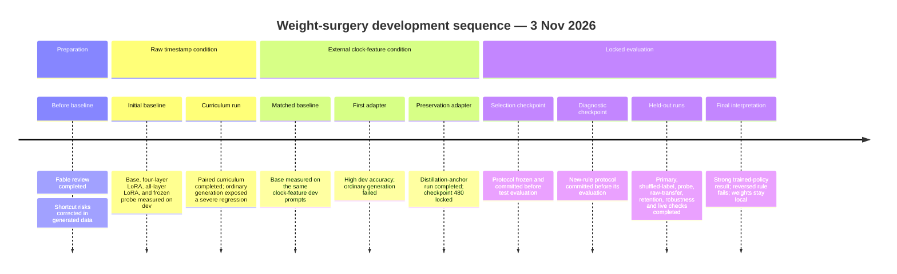

# Qwen3 temporal weight-surgery journey

- **Date:** 3 November 2026
- **Branch:** `experiment/temporal-weight-surgery`
- **Updated through:** 2026-11-03 07:15 UTC
- **Status:** Locked-checkpoint evaluation is complete. The adapter succeeds on the four trained clock-feature policies but fails the predeclared reversed-rule diagnostic and ordinary arithmetic generation. The scope is an experimental gated specialist, not general temporal intelligence.

This log records the research and attempts so far, including unsuccessful ones. The concise [final results report](weight-surgery-results.md) summarizes the decision and evidence. Raw artifacts and adapter checkpoints remain in the locally ignored `artifacts/weight-surgery-20261103/` directory. The compact [run index](../evidence/weight-surgery-20261103/journey-index.json) maps each explicit run ID to its local evidence and source hashes. The selected local adapter is named **TickLM TimePatch 0.6B**, an experimental, explicitly gated specialist. Safe evidence archives are listed below. No model weights have been uploaded.

## Research review and checkpoint identity

Before training, a Claude review was run with requested and resolved model `claude-fable-5-1` at `xhigh` effort. The saved JSON records `elapsed_s: 204.97264645798714` (204.97 seconds) and estimated cost `$1.00581875`. The prompt requested at most 650 words. Separately, wrapper metadata records `requested_max_tokens: 8` and `max_tokens_enforcement: not_enforced`; this was not a prompt instruction and did not constrain the response. The review is recorded model feedback, not independent research verification. Its prompt and response remain in `artifacts/weight-surgery-20261103/fable-plan-prompt.txt` and `fable-plan-review.json`.

The local checkpoint is `models/qwen3-0.6b-bf16-c1899de`; run manifests record revision `c1899de289a04d12100db370d81485cdf75e47ca`, supplied by the caller. MLX reports 596,049,920 loaded parameters. The checkpoint files contain 751,632,384 stored tensor elements, including tied or duplicated tensors; that is not the active parameter count.

Before the held-out evaluation, a second Claude review of the supplied results used `claude-fable-5-1` at requested `xhigh` effort. It took **301.318 seconds** and reported an estimated cost of **$1.48018875**. It prompted a diagnostic with a reversed threshold rule and a two-sided time window. The exact prompt and response are indexed as `fable-results-review-prompt.txt` and `fable-results-review.json`; corrections and scope limits are in [weight-surgery-review-notes.md](weight-surgery-review-notes.md). This was a review of the local evidence packet, not an independent replication or literature search.

## Data corrections and raw-input baseline

Before the original baseline, the generated benchmark was red-teamed and corrected to vary fractional margins on both sides of decision boundaries, include equality only for a subset of positives, separate relevant events from mismatched or earlier events, and balance reset presence across sustained-condition outcomes. Pair members retain the same choices and differ in one input. These generated cases test rule-following; they do not establish that an LLM is needed for these decisions.

The original raw-input development set contains 256 cases and has SHA-256 `32e346074349a11f3db710adfc672c162e14f21c653c6eee1868126c0f518656`. The initial 1,024-case training set hash is `44e947dc2d6792c5bbe0b91e686bcc95e9f047a63bae97c337b625466ce502e8`. Public rendering and robustness helpers later changed the source hash without changing that saved dev data. The train-only curriculum created a new training set, hash `e053a80c29c82772c3e98a9a4113ad4a873d32c3f9889614ac4bd2036fa803ec`, while keeping the original dev set unchanged.

The unmodified base scored **37.890625%** item accuracy and **0.78125%** pair-both-correct accuracy on raw-input dev. The deterministic reference scored 100% on these generated labels. A separate base-generation smoke run on three fixed prompts is retained for later comparison.

## Raw-input adaptation attempts

`lora4-choice-s1103` used rank-8 LoRA on query/value projections in the last four layers, choice-only cross-entropy, learning rate `3e-4`, batch size 4, seed 1103, and 160 steps on 1,024 training cases. It exposed 163,840 trainable parameters, **0.02749%** of the loaded count. The suggested checkpoint, step 96, scored **41.40625%** item accuracy and **0.78125%** pair-both-correct, unchanged from base. The retained non-temporal dev smoke set scored 41.67%; adapter reload parity had maximum logit difference zero. The paired endpoint did not improve, so this run does not support a temporal-reasoning claim.

`lora28-full-s1103` trained rank-8 query/value LoRA in all 28 layers for 600 steps with full-vocabulary loss, learning rate `3e-4`, batch size 8, and multiple-choice retention anchors every five steps. It trained 1,146,880 parameters (**0.1924%**). The CLI suggested step 240: **51.171875%** item accuracy, **2.34375%** pair-both-correct, and 62.5% retention accuracy. Deadline, silence, and sustained-condition accuracy were each 50%; relevance was 54.6875%. At step 600 retention accuracy was 72.9167%, but the time-focused families remained near chance and pair consistency remained low. The exact command and hashes are in the run index and `lora28-full-s1103/run.json`.

The frozen-base hidden-state probe used the original 1,024 train and 256 dev cases. It scored **44.53125%** item accuracy and **3.125%** pair-both-correct. It is a readout control, not a fine-tuned model. Its paired score exceeds the raw base and best raw-input all-layer LoRA suggestions, but remains low; it does not show improved temporal behavior from weight adaptation.

`lora28-curriculum-s1103` completed its 1,000-step paired, train-only time-scale/offset curriculum in **631.57 seconds**. The dev-selected suggestion is step 800, at **51.171875%** item accuracy, **3.125%** pair-both-correct (4 of 128 pairs), and 68.75% retention multiple-choice accuracy. Step 1,000 reached 50% item accuracy. These results do not support a temporal-reasoning claim.

The raw curriculum adapter failed the ordinary-generation review. On four short non-temporal passages (66 scored tokens), its cross-entropy was 3.3436 versus 3.3685 for base, with mean base-to-adapter KL divergence **0.2036 nats**. Yet on the fixed prompt “What is 17 plus 25?” it repeatedly generated `100`; sky and greeting responses also became repetitive. The passage score was too small to establish language retention. The complete outputs are in `curriculum-generation/generation.json`; the separate dev passage evaluation is in `curriculum-retention-dev/metrics.json`.

## External clock-feature condition

This is a deliberately different input condition. A formatter supplies external elapsed or relative-time measurements while preserving the original prompt and choices. It does not supply an action, target-match boolean, or threshold comparison. This relaxes the requirement that the model perform subtraction internally; success would show use of supplied clock measurements on these synthetic rules, not intrinsic elapsed-time calculation.

The matched unmodified-base run, `base-features-dev`, used the same 256 development situations after this transformation. It scored **44.140625%** item accuracy and **3.125%** pair-both-correct. Its transformed dev prompt dataset hash is `bb40ca241ef61a32a72efdd54b94f0781e36589401db91bf12528f234b0028f7`.

The completed `lora28-features-s1103` run used the same clock-feature view with all-layer rank-8 query/value LoRA, full-vocabulary loss, 600 steps, batch size 8, learning rate `3e-4`, curriculum, paired minibatches, and multiple-choice anchors every five steps. Checkpoint 240 scored **85.9375%** item accuracy and **71.875%** pair-both-correct; checkpoint 360 scored **96.875%** and **93.75%**. The dev selector suggested step 480, which tied step 600 at **99.609375%** item accuracy and **99.21875%** pair-both-correct. Retention multiple-choice accuracy at both steps was **62.5%**. The training process reported **4.88 GB** peak memory; this is process high-water usage, not model-only or inference-only memory. These are development results under external clock assistance on synthetic rules; they are not held-out results or evidence of general temporal reasoning.

The free-generation review used the suggested step-480 adapter; its run manifest and outputs are `features-generation/run.json` and `features-generation/generation.json`. It answered `17 + 25` as 42 but continued repeating the answer; its sky explanation incorrectly said blue light is absorbed and repeated itself. The greeting was acceptable. This first clock-feature candidate is not acceptable as a general-chat patch despite its development accuracy.

The run's source hashes and saved transformed train/dev datasets are recorded in `lora28-features-s1103/run.json`. The feature-view dev set is the same as `base-features-dev`; its transformed prompts differ from the original raw-input dev prompts. Comparisons must keep that input condition aligned.

## Preservation run and locked checkpoint

The completed `lora28-features-distill-s1103` run used all-layer rank-8 query/value LoRA, full-vocabulary loss, curriculum, paired minibatches, and distillation anchors every five steps on the clock-feature input view. It ran 600 steps in **393.269 seconds**. Step 480 scored **100%** item accuracy and **100%** pair-both-correct on dev; step 480 was selected before test. Its development retention multiple-choice score was **18/48**, versus **17/48** for base.

The ordinary-generation review of the selected adapter is in `distill-generation/run.json` and `distill-generation/generation.json`. The sky and greeting responses were coherent, but “What is 17 plus 25?” returned `17.`. The adapter is therefore rejected as an always-on chat patch. The working name for the local specialist is **TickLM TimePatch 0.6B**; use is gated so the adapter is enabled only for temporal choices and the original model serves ordinary requests.

Selection was locked at **06:51:15 UTC** in `selection-lock.json`, committed as `9e7af2e`, before any held-out model evaluation. The lock names `checkpoint-000480`, records its adapter/config/manifest hashes, and defines the four-family evaluation. The provisional pass bar was selected after development and before test: at least 70% both-correct pair accuracy and at least 20 percentage points above the identical-input base. It was not an original preregistration.

## Held-out primary comparison

On the 256 locked test items and 128 complete counterfactual pairs, the selected adapter scored **256/256 items and 128/128 pairs** using external clock features. The unmodified base on the identical prompts scored **111/256 items and 3/128 pairs**. The paired bootstrap comparison, retained in the [final evidence archive](../evidence/weight-surgery-20261103/final-evaluation.tar.gz) as `heldout-primary-comparison.json`, used 10,000 resamples over pairs: item-accuracy gain **56.640625 percentage points** (95% interval **53.125–60.15625**); pair-both-correct gain **97.65625 points** (95% interval **94.53125–100**). These intervals describe variability across this synthetic sample, not training-seed or real-world uncertainty.

The fixed controls were much lower: the shuffled-label adapter at the protocol-fixed checkpoint 480 scored **67/256 items and 1/128 pairs**; the matched frozen probe scored **112/256 items and 4/128 pairs**. The shuffled control's automatically suggested checkpoint 240 was not used. On raw-input transfer (`selected-test-raw/metrics.json`), the selected adapter scored **136/256 items and 10/128 pairs**, versus **98/256 and 0/128** for base (`base-test-raw/metrics.json`). The adapter's primary 100% result is specific to the clock-feature prompts and trained policy set; it does not establish general temporal reasoning.

## Novel-rule diagnostic and robustness

The diagnostic protocol was saved before its outputs in `novel-rule-protocol.json`, alongside code checkpoint `a3f82eb`. With 32 counterfactual pairs per condition, the selected model got the familiar-policy control right on **32/32 pairs**, the reversed comparison right on **0/32**, and the two-sided window right on **16/32** (`novel-selected/metrics.json`). The protocol forbade retraining, checkpoint replacement, or threshold tuning based on these outputs. This supports a strict policy-limited interpretation: the adapter fits the four trained policies but does not follow a changed temporal rule reliably.

The selected model scored **256/256 items and 128/128 pairs** on each of four narrow robustness conditions: primary, option rotation, absolute-time translation, and an independent in-range number sample. Rotation and translation preserved the same action on **256/256 matched items**. These controls check formatting and nuisance changes under the trained policies; they do not contradict the novel-rule failure. `selected-robustness-test/metrics.json` is the aggregate record.

## Retention, gate, and live replay

The selected adapter's ordinary-retention multiple-choice test scored **15/48**, versus **17/48** for base. A separate four-passage, 57-token cross-entropy check (`selected-retention-test/metrics.json`) measured 3.4481 for the adapter and 3.5204 for base, with mean KL divergence **0.2295 nats**. These small checks do not certify active-language retention; the arithmetic generation failure remains.

The explicit gate passed a real-checkpoint parity check (`selected-gate-verification/metrics.json`): disabling the adapter yielded **zero maximum logit difference**, **3/3** identical greedy strings, and the same **310** base tensor objects. This verifies reversibility in this implementation; it does not make the active adapter generally safe.

In five scripted monotonic-clock snapshots (`live-selected/summary.json`), the selected gated path was correct on **5/5 snapshots** and marked **4/5** actions eligible for publication. The cancellation arrived during inference and the deterministic check marked the outdated answer unpublishable against the post-inference state. The base path (`live-base/summary.json`) was correct and eligible on **3/5**. Total observed durations were 1.7953 seconds for selected and 1.7802 seconds for base. The replay records decisions; it does not implement atomic checking and publication to an external recipient. This small replay is not a latency or generalization benchmark.

## Validation, archives, and remaining limits

The first saved full-suite transcript contains two probe-test `AttributeError` failures from an older loaded module; that failed attempt is retained. Intermediate validation passed 217 tests with one skip. The final suite passed **241 tests with 1 skipped in 11.52 seconds**, and Ruff reported **All checks passed!** (`verification-pytest-final.txt`, `verification-ruff-final.txt`). The current code checkpoint is `a3f82eb`.

The published evidence includes five development and preservation archives: `completed-development-runs.tar.gz` (SHA-256 `2cc0909442ddd77c53970b26c8a8a3111dd5740318975c907f3bb2923cc21521`), `curriculum-development-run.tar.gz` (`7fe87e98cd128784ba59b7b1d824267a2ecc9f10717bb9f966664656ed198e23`), `duration-baseline-and-retention-failure.tar.gz` (`b6a9c814e65739400e17cdd87e27f6bab066286da337a2ba615a8ffc6315cafa`), `clock-feature-development.tar.gz` (`c37b074d3a04b83366c6ffc37dfab7c40cbca593f7f177bdceb4a54c2e5cbc19`), and `preservation-development.tar.gz` (`d6287b14b843720241a2b41caf28e7f4b2a042192bdc277c1643b982bb614f49`). The final results checkpoint adds `final-evaluation.tar.gz`, SHA-256 `e0d3fda3858f396aa1fbeab7b66baedef02dfd4389a4c08a02f5aa7040523f7c`, together with this journal and the result report. The archives omit model and adapter weight files; those remain local and have not been uploaded.

MLX peak-memory values are process high-water marks, not isolated inference memory ([MLX documentation](https://ml-explore.github.io/mlx/build/html/python/_autosummary/mlx.core.get_peak_memory.html)). No further model runs are planned. The results support an experimental, gated adapter for the four trained synthetic policies with external clock arithmetic; the unseen-rule and arithmetic-generation failures rule out a broad temporal-intelligence or general-chat claim.
