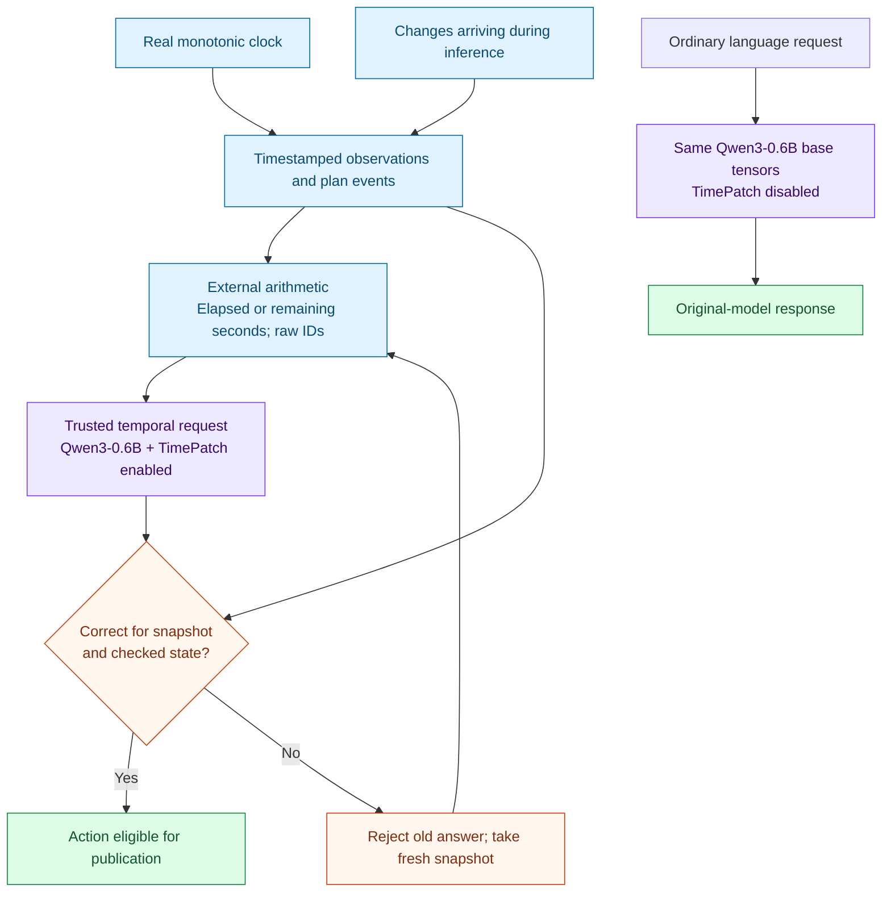

# TickLM TimePatch: a learned temporal specialist

**Measured on 3 November 2026. Experimental, with explicit task routing.**

We trained a small, reversible adapter for **Qwen3-0.6B**. Given durations calculated by an external clock program, it chooses the right action for four trained kinds of situation: silence, deadline lead time, a change to a plan, and a condition that must remain true for a duration.

The selected adapter answered **256 of 256 held-out questions correctly**, including **both members of all 128 counterfactual pairs**. It also made **5 of 5 correct snapshot decisions** in a short real-clock test. However, it failed completely when a familiar threshold rule was reversed, and its active weights damaged ordinary arithmetic. The working prototype therefore enables the adapter only for explicit temporal-controller requests and disables it for ordinary language requests on the same base model.

This is evidence that a small weight adapter can learn these policies from supplied time measurements. General temporal instruction-following, an internal clock, and fusion with TimesFM or the local 17M decision model remain unproved.

## What actually runs

| Component | Exact implementation | Responsibility |
|---|---|---|
| Clock and event state | Python `time.monotonic()` and timestamped state | Measure passing time and record events while inference is running. |
| Input formatter | `surgery_features.with_feature_view` | Calculate primitive durations and retain original timestamps, thresholds, choices and plan IDs. It does not calculate the answer. |
| Language-model backbone | Official `Qwen/Qwen3-0.6B`, BF16, revision `c1899de289a04d12100db370d81485cdf75e47ca`, MLX | Supply the shared language-model computation; **596,049,920 base parameters stay frozen**. |
| TimePatch | Rank-8 low-rank adaptation (LoRA), query/value projections in all 28 layers | Train **1,146,880 added adapter parameters**, about **0.1924%** of the base parameter count. |
| Task gate | `surgery_gate.adapter_mode` | Enable the patch for controller decisions; set its contribution to zero for ordinary requests. The caller chooses the mode explicitly. |
| Publication check | `surgery_live.release_assessment` | Check the chosen action against a post-inference state snapshot; reject it if wrong for the original or checked state. |

The earlier TickLM experiments used local Qwen3-4B, TimesFM 3.0, Claude Code and Codex. **This weight-training experiment uses Qwen3-0.6B only.** TimesFM and the 17M decision model are not inputs, teachers, or merged weights here. Fable 5.1 through `cca startup`, with `xhigh` effort requested and the resolved model recorded, reviewed the design and findings; it did not supply training labels.



The gate uses one shared model, with fresh attention caches for each request. Its contexts serialize access and restore adapter scales after exceptions. Same-thread asynchronous interleaving, reused cross-mode caches and graphs compiled with another scale are unsupported. This is an experimental inference path, not a production serving system or an automatic router for mixed conversations.

## What we trained and measured

Each training run used **1,024 synthetic temporal examples**. The development set contained **256 examples in 128 pairs**. Within a pair, the answer options stay fixed and one causally relevant input changes; the correct answer must change. Getting only one member right can reflect a constant guess, so complete-pair accuracy is the primary measure.

The final test uses different generated situations and body wording. The clock-feature prefix has the same schema across splits. Time-scale and offset augmentation deliberately covers broader numerical ranges, so the final result is **not a test of numerical extrapolation**. The held-out cases are new examples of the trained policies.

The successful format gives the model primitive measurements such as `now − last_event`, `deadline − now`, time since the latest reset, and event time relative to plan issue. The model still has to compare values with thresholds and interpret the relevant plan IDs. No action, comparison result, signed threshold margin, target-match Boolean, or gold metadata is included in the prefix.

We tried six adapter runs, retaining every one:

| Development attempt | Steps | Correct individual answers | Complete pairs correct | Interpretation |
|---|---:|---:|---:|---|
| Raw timestamps, last four layers, choice loss | 160 | 41.41% | 0.78% | Failed to improve paired behavior. |
| Raw timestamps, all 28 layers, full-vocabulary loss | 600 | 51.17% | 2.34% | Mostly insensitive to the changed fact. |
| Raw timestamps, broader time curriculum and paired batches | 1,000 | 51.17% | 3.13% | Still failed; ordinary generation also regressed. |
| External durations, same curriculum, multiple-choice anchors | 600 | 99.61% | 99.22% | Learned the trained policies; damaged ordinary generation. |
| External durations, frozen-base token-distribution anchors | 600 | 100% | 100% | Selected checkpoint 480; ordinary arithmetic still fails with the adapter active. |
| Same final recipe, shuffled temporal training answers | 600 | 24.61% | 0.78% | Negative control evaluated at fixed step 480, irrespective of its automatic development suggestion. |

The first three rows and the next two are different input/training conditions, not a clean single-variable ablation. The primary causal comparison below uses the original and adapted model on **identical inputs**. The [journey](weight-surgery-journey.md) records the reasons for each change, intermediate checkpoints, failed verification attempts and source/dataset hashes.

The selected recipe uses learning rate `3e-4`, batches of eight, full-vocabulary answer-token loss, and one preservation update every five steps. Preservation imitates the frozen base's token distributions on **eight separate training continuations**, including its prediction after the final answer token. The backbone stays frozen. The selected run completed 600 steps in **393.27 seconds (6 minutes 33 seconds)**, including periodic development checks but excluding initial loading and teacher caching; checkpoint 480 was selected on development data. Its adapter file is **4,599,549 bytes**. MLX recorded a **4.87 GB process high-water mark** during the run; this is not isolated inference memory. A small trainable fraction does not imply the same fraction of training or inference computation.

## Locked held-out result

The checkpoint and protocol were committed in [selection-lock.json](../evidence/weight-surgery-20261103/selection-lock.json) before test evaluation. No checkpoint or training setting changed after these results. All rows use the same 256 clock-feature prompts; the frozen classifier used exactly the same temporal training dataset as the adapter, verified by its hash.

| System | Individual answers | Complete pairs |
|---|---:|---:|
| Original Qwen3-0.6B | 111/256 — 43.36% | 3/128 — 2.34% |
| Frozen Qwen plus trained linear classifier | 112/256 — 43.75% | 4/128 — 3.13% |
| Adapter trained with shuffled answers | 67/256 — 26.17% | 1/128 — 0.78% |
| **Selected TimePatch** | **256/256 — 100%** | **128/128 — 100%** |
| Deterministic reference | 256/256 — 100% | 128/128 — 100% |

The selected model's unrestricted next token was also the correct answer letter on all 256 cases; the result is not limited to renormalizing four candidate scores. The original-model comparison gives an individual-accuracy gain of **56.64 percentage points**, with a pair-resampled 95% interval of **53.13 to 60.16 points**. The paired-success gain is **97.66 points**, interval **94.53 to 100 points**. These intervals describe this synthetic sample, not training-seed variation or real-world reliability.

Option rotation, absolute-time translation, and an independently sampled set of in-range numbers each retained **256/256 answers and 128/128 pairs** for the selected adapter. Rotation and translation preserved all semantic decisions. These are related controls, not independent benchmark replications; the robustness command also repeats the primary cases to calculate consistency.

Without the duration prefix, the selected adapter falls to **136/256 answers and 10/128 complete pairs**. The raw-input original model gets **98/256 and 0/128**. The successful result therefore depends strongly on the external arithmetic interface.

## Where generalization fails

Fable's second review prompted an additional diagnostic, specified before its outputs were produced in [novel-rule-protocol.json](../evidence/weight-surgery-20261103/novel-rule-protocol.json). The model received a new rule without further training. A matched familiar-rule control uses exactly the inverted cases' states and options; its prompt differs only in the comparison phrase.

| Rule | Original model: complete pairs | Selected adapter: complete pairs |
|---|---:|---:|
| Familiar: alert at or above the threshold | 1/32 | **32/32** |
| Reversed: alert strictly below the threshold | 2/32 | **0/32** |
| Window: alert only between two inclusive bounds | 0/32 | **16/32** |

The reversed-rule adapter answers are all wrong, not merely low-confidence. This sharply limits the claim: the adapter learned the trained policy, but does not reliably follow a changed rule stated in the prompt. Its 75% individual score on the window task also hides a 50% complete-pair score. We did not retrain on these failures or replace the selected checkpoint.

Ordinary language is a separate failure. With the selected adapter active, `What is 17 plus 25?` returns `17.` The small test retention set falls from **17/48 to 15/48**. Four ordinary passages produce slightly better teacher-forced cross-entropy (3.448 versus 3.520 over 57 tokens), but that does not repair the wrong arithmetic. The active adapter is unsuitable as a general chat replacement.

With the adapter disabled on the same model, the three checked greedy responses match the original exactly, including `17 + 25 = 42.` All checked first-token logit differences are zero, and all **310 base tensor objects** remain shared. This verifies the routing mechanism on the inspected requests; it does not certify broad language quality of the active adapter.

## Real passing time and an event during inference

The selected live run lasts **1.795 seconds after warmup**, with **five snapshots** and a **1.5-second silence threshold**. Events are scripted within the process; elapsed time is measured by the real monotonic clock. It is separate from the earlier 201-reading Qwen3-4B/TimesFM demonstration.

Here is the actual calculation for the second snapshot, using seconds relative to the live run's monotonic-clock origin:

```text
A: last observation              0.000000000 seconds
B: snapshot                     1.660025625 seconds
External program computes B-A   1.660025625 seconds
Threshold                       1.500000000 seconds
Model's action                  ALERT
```

Python computes the subtraction. The trained model chooses the action from the supplied duration and threshold. It does not independently measure the interval.

| Snapshot | Model action | Correct for snapshot? | Publishable after inference? |
|---|---|---|---|
| Before the silence threshold | Wait | Yes | Yes |
| After actual time passes | Alert | Yes | Yes |
| A new observation resets the silence interval | Wait | Yes | Yes |
| Cancellation initially targets another plan | Continue | Yes | **No — the target changes during inference** |
| Fresh snapshot after cancellation targets this plan | Stop | Yes | Yes |

The fourth inference runs from **1.736561 to 1.766390 seconds**. The relevant cancellation arrives at **1.744010 seconds**, inside that interval. The model's old `continue` decision is correct for its snapshot; the deterministic check marks it unpublishable against the post-inference state because the plan is now cancelled. A fresh decision returns `stop`. Snapshot correctness is **5/5**, and **4/5** answers are eligible under this check. The replay records these decisions; it does not implement an atomic check-and-publish operation to an external recipient. The original-model live run gets **3/5** snapshot decisions right. These are two short scripted trials with their own timings, not a reliability or speed ranking.

The selected run's five decision calls took **28.8–47.4 milliseconds** each. Afterward, the same process disables the adapter and generates the three ordinary responses, including the correct arithmetic answer. Hard deadlines and publication validity remain the controller's responsibility.

## Reproduce and inspect

The [evidence index](../evidence/weight-surgery-20261103/journey-index.json), [archive guide](../evidence/weight-surgery-20261103/README.md), and [review corrections](weight-surgery-review-notes.md) link the configurations, datasets, per-case predictions, logs and failed attempts. Code and measurements are pushed on `experiment/temporal-weight-surgery`. Base weights, teacher arrays, probe arrays and adapter files remain under ignored local directories; this is not a model-weight release.

With the pinned local base and the retained adapter:

```sh
.venv/bin/python -m temporal_bridge.surgery_live \
  --model models/qwen3-0.6b-bf16-c1899de \
  --revision c1899de289a04d12100db370d81485cdf75e47ca \
  --adapter artifacts/weight-surgery-20261103/lora28-features-distill-s1103/checkpoint-000480 \
  --input-view clock-features --gated \
  --output artifacts/my-timepatch-live-run
```

Use a fresh output directory. The full training recipe is in the selection lock and original `run.json`; append `--anchor-mode distill --anchor-every 5 --curriculum --paired-batches --input-view clock-features` to the documented 600-step training configuration. Omitting the adapter restores the original model; the original checkpoint has not been overwritten.

Final software verification: **241 passed, 1 skipped in 11.52 seconds**, and **Ruff: All checks passed!** This is one training seed, four synthetic trained policies, two new-rule diagnostics and a short live replay. Deterministic rules remain cheaper and perfect for these tasks. The next scientific question is whether training across varying rule semantics produces transferable decisions; the present evidence does not establish that capability or justify adding TimesFM or a separate decision model yet.
